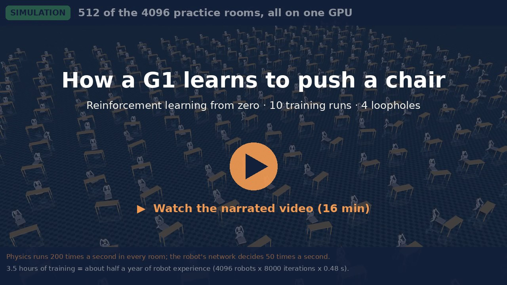
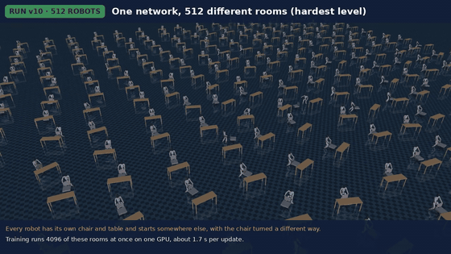

# IST5930 — G1 chair push

A trained policy for the Unitree G1 humanoid: walk to a rolling chair, take the backrest with
both hands, and push the chair under a table (success = the backrest touches the table edge).
Everything here runs on a laptop CPU. You can test it in MuJoCo (sim2sim) first, then run the
same code on the real robot.

## Watch first: how a G1 learns to push a chair (16 min, narrated)

[](https://github.com/ytphi/ist5930-g1-chair-push/releases/download/videos-2026-11-18/g1_training_explained.mp4)

**[▶ Download / watch `g1_training_explained.mp4`](https://github.com/ytphi/ist5930-g1-chair-push/releases/download/videos-2026-11-18/g1_training_explained.mp4)** (120 MB)
- **Part 1, 0:00–5:53: G1 training from zero.** Why we train in simulation, the control loop, what the robot sees,
  the reward score, PPO, one training run seen at six moments, the curriculum, the planner, and how a policy gets to the real robot.
- **Part 2, 5:53–15:53: ten training runs, v1 → v10.** Every reward loophole the robot found (four of them), and the fix for each.

Short clips: [512 robots](media/v10_512_robots.mp4) · [palm close-up, v10](media/v10_side_grip_closeup.mp4) ·
[all videos](https://github.com/ytphi/ist5930-g1-chair-push/releases/tag/videos-2026-11-18)

## Why we do this, and how the training works

**The goal.** A real Unitree G1 humanoid walks up to a rolling office chair, holds the backrest with both hands,
and pushes it under a table. We don't program the walking or the pushing by hand. Balancing on two legs while a
rolling chair pushes back is very hard to write as rules, so the robot **learns it by trial and error** (reinforcement learning).

**Where it learns.** It learns in a physics simulator (MuJoCo, through [mjlab](https://github.com/mujocolab/mjlab)), with
4096 robots in 4096 separate rooms on one GPU. One 3.5-hour run equals about half a year of robot practice, and no real
robot falls over in the process.



**What is learned.** One small neural network: 108 numbers in, 29 numbers out, layers 512 → 256 → 128 (about 220 000 weights).
- It runs 50 times a second.
- **Inputs (108):** the robot's own body (gyro, gravity direction, 29 joint angles and speeds, its last action) and
  the task (walking command, phase, where the chair is, where the chair must go).
- **Outputs (29):** a target angle for each motor. The motors' PD controllers pull the joints toward those targets.
- No camera image goes into the network. On the real robot, AprilTags on the floor and on the chair give the positions.

**How it learns.**

| Piece | What it does |
|---|---|
| **Reward** | A score every step. Points for the job (chair moves toward the table, hands on the backrest, palms facing in, finishing) and for moving well (following the command, staying upright). Penalties for falling (the biggest), leaning, tipping the chair, bumping the table, or stalling. |
| **PPO** | Each iteration, every robot acts for 0.48 s (≈ 98 000 moves in total). Moves that scored better than expected become slightly more likely, worse ones slightly less. ≈ 1.6 s per iteration, thousands of iterations. |
| **Curriculum** | It starts easy: the chair is close and lined up with the table. Every 10 s of simulation, if more than 60 % of robots succeed, the layouts get harder: farther, off to the side, turned the wrong way. |
| **Planner** | A small hand-written state machine: APPROACH → GRIP → PUSH → DONE. It tells the network where to walk and how fast. The network does the balance, the steps and the hands. The same planner (numpy) runs on the real robot. |
| **Sim2sim** | Before the real robot, the exported ONNX file runs in a second simulator with the real deploy code and a fake AprilTag camera. This catches problems training never shows: missing tags, stale positions, leaning. |

**The ten runs.** Each run fixed exactly what the previous one taught us. The lesson: *the robot learns what you score, not what you want.*

| Run | What happened | Fix in the next run |
|---|---|---|
| v1 | Learning to stand and walk; one simulated room's physics blew up (NaN) and crashed the run | Reset broken rooms instead of crashing |
| v2 | **Loophole 1:** stood 30 cm short and reached out, collecting hand points | Pay hand points only after arriving |
| v3 | **Loopholes 2–3:** rushed in for the arrival bonus and fell; then crouched and shook to "arrive" 150 times | Bonus once per episode, only when upright; falls cost more |
| v4 | Learned the real task (about half succeed), then crashed on a sensor NaN | Guard every observation and reward |
| v5 | 99.6 % at the easy level, 66 % at the hardest: frozen with a turned chair; leaned 34° on the chair | Lean penalty, "stand still" training |
| v6 | Lean fixed (34° → 16°), but ignored "stand still" and walked to the chair anyway | No grip phase while told to stand |
| v7 | Stands on command (drift 1.56 m → 0.18 m); still 67 % at the hardest level | Grip the backrest corners |
| v8 | Corner grip: 80 %, turned chairs 2 % → 86 %. Then **loophole 4:** perfect grip, barely pushing (8 %) | Pay grip points only while the chair moves |
| v9 | 99.6 % at the hardest level, but the right hand lay flat on top of the backrest | Reward palms facing each other |
| **v10** | Right palm facing in 2 % → 100 %, success 98.7 %, falls 0.1 % | (this release) |

Total: 10 runs in six days, 12.9 GPU-hours on NRP.

## Next steps

For the real-robot demo:
- **Search for the chair.** When the chair tag isn't in view at the start, the robot stands and waits; that's almost every sim2sim failure.
  It needs a "turn and look" behaviour. Turning in place on command was never learned (tested on v7).
- Run the full task on the floor in CGI-112, after gantry tests and joystick walking (see `deploy/README.md`).
- Mount the chair tag firmly on a stiff board trimmed to the paper, and check the camera mount with a tape measure.

For a better policy (v11 and later):
- **Don't depend on sensor noise.** v9/v10 were trained with noisy observations. With perfectly clean readings,
  success drops from 98.8 % to 27 % (v10) and the robots freeze mid-push. Real sensors are noisy too, but this is fragile.
- Take real steps instead of shuffling (reward foot air time; loosen the hip and knee pose terms).
- Same task with several random seeds and a fixed test set, so results can be compared fairly.
- Learn walking style from the students' motion-capture recordings.

## What's in this repo

```
media/      videos (mjlab, 512 robots; hand close-up) and the video thumbnail
policies/   trained ONNX policies (the joint order, gains and observation layout are stored in each file)
deploy/     deploy code, AprilTag perception, tag layouts, MuJoCo scene (see deploy/README.md)
```

## Policies

| File | What it is | Training sim, level 1 | Sim2sim (20 seeds, levels 0 / 0.2 / 0.3 / 0.5) |
|---|---|---|---|
| `policies/chair-push-v10.onnx` (**default**) | Side grip: both palms face inward on the backrest corners | 98.7% success, 0.1% falls | 20 / 13 / 10 / 1 |
| `policies/chair-push-v9.onnx` | Same task, but the right hand lies palm-down on the backrest | 99.6% success | 20 / 12 / 12 / 9 |

How to read the sim2sim column: almost every failure is a run where the chair's AprilTag is
**never seen** from the start pose, so the robot stands and waits. v9 often finds the tag by
luck, because it spins a little when told to stand still. v10 stands still as trained. Counting
only runs where the chair tag was seen: v9 53/53, v10 44/45 (one fall, level 0.2 seed 3).
On the real robot you start the task only after the chair tag is seen (button A, below).

## 1. Install (laptop)

```bash
git clone https://github.com/ytphi/ist5930-g1-chair-push.git
cd ist5930-g1-chair-push
python3 -m venv .venv && source .venv/bin/activate
pip install -r requirements.txt
```

For the real robot, also install [unitree_sdk2_python](https://github.com/unitreerobotics/unitree_sdk2_python).
Use **Python 3.10** for it. With Python 3.11, every DDS topic failed with `PRECONDITION_NOT_MET` on our machine.

## 2. Sim2sim (no robot needed)

```bash
python deploy/g1_chair_deploy.py --sim --policy policies/chair-push-v10.onnx \
    --tags deploy/tags_sim_planned.yaml --seed 0 --level 0 --duration 30 --video sim.mp4
```

It prints the phase (APPROACH → GRIP → PUSH → DONE) once per second and ends with `SUCCESS` or
`no success (...)`. Try other `--seed` values and `--level 0.2`, `0.3`, `0.5` (harder starting layouts).
Use `--tags deploy/tags_sim_planned.yaml` in sim. With the classroom layout in `deploy/tags.yaml`,
the simulated robot starts where it can't see any floor tag, so it waits forever.
Add `--log run.jsonl` to save every step (commands, joint angles, tilt, tags seen).

## 3. Real robot

Follow the **test order in [`deploy/README.md`](deploy/README.md)** and don't skip steps:
camera check, calibration check, standing in the gantry, joystick walking, then the full task.
The short version:

- Print the tags in `deploy/apriltags/apriltags_tag36h11.pdf` (ids 0 and 10–14). Measure the black square and
  pass it as `--tag-size`. Tape the floor tags where `deploy/tags.yaml` says, or measure your own
  layout and edit that file.
- On the robot's PC2: `apriltag_perception.py` streams tag poses to the laptop over UDP.
- On the laptop: `python deploy/g1_chair_deploy.py --net <your NIC> --policy policies/chair-push-v10.onnx --command planner`
- Remote: **START** = the policy takes over and stands; **A** = start the chair task (press it only
  with the feet on the floor and after the log shows `chair tag seen >= 90%`); **SELECT** = damping + exit.
- Always have a spotter and a gantry or safety rope. Leave 5–10 cm of slack in the rope, because a tight rope
  pulls the robot and makes it shuffle and spin.

## License

The code and policies are released under the [MIT License](LICENSE). The G1 meshes keep their original license (see below).

## Credits

The G1 meshes in `deploy/assets/chair_scene/assets/` come from Unitree's G1 model as packaged in
[mjlab](https://github.com/mujocolab/mjlab) and stay under their original license. The policies were trained with mjlab 1.6.0 (PPO, 4096 environments).
